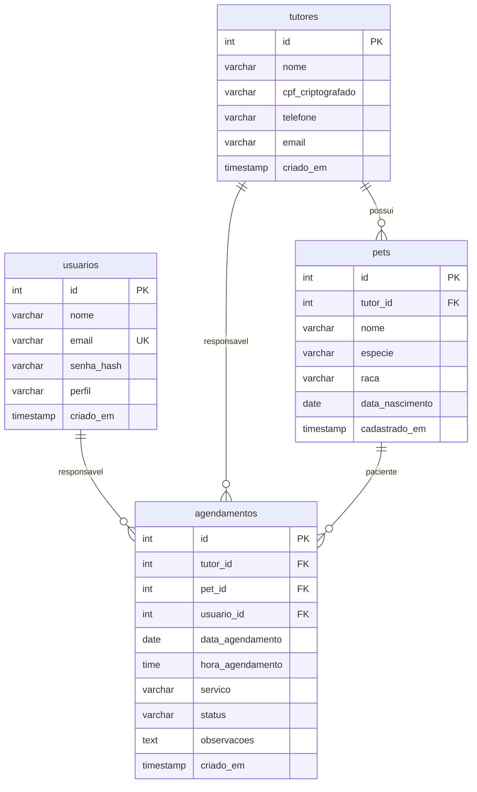

# SisVet — Sistema de Gestão Veterinária

Projeto desenvolvido para a avaliação prática do SAEP. A aplicação oferece autenticação e telas para gerenciar tutores, pets e agendamentos de uma clínica veterinária.

## Tecnologias e arquitetura

- PHP 8.2 ou superior
- PostgreSQL com PDO e consultas preparadas
- MVC próprio, com autoload PSR-4 configurado no Composer (`App\\` → `src/`)

## Requisitos

- PHP com as extensões PDO, PDO_PGSQL e OpenSSL habilitadas
- Composer
- PostgreSQL

## Configuração e execução local

1. Crie o banco `saep_db` no PostgreSQL (ou ajuste o nome no arquivo de configuração).
2. Revise as credenciais e a porta em `Prova032026/sistema/config/database.ini`. O padrão do projeto usa `127.0.0.1:5433`, banco `saep_db`, usuário `postgres` e senha `postgres`.
3. Execute `Prova032026/schema.sql` conectado ao banco criado. Antes, substitua os marcadores `SUBSTITUA_PELO_HASH_ARGON2ID_GERADO_EM_PHP` por hashes válidos. Para gerar um hash para a senha `123456`, execute em PHP:

   ```php
   echo password_hash('123456', PASSWORD_ARGON2ID);
   ```

   O script também inclui o usuário `k@g.com`, cuja senha indicada é `123`. Os registros de CPF de exemplo no script não são produzidos pela rotina de criptografia da aplicação; use CPFs cadastrados pela própria tela para dados válidos.
4. Gere o autoloader e inicie o servidor embutido do PHP:

   ```powershell
   cd Prova032026/sistema
   composer dump-autoload
   php -S localhost:8000 -t .. ..\index.php
   ```

5. Acesse <http://localhost:8000/>. O login é exibido em `/login`.

Também é possível configurar o servidor web com `Prova032026` como raiz do site; o arquivo `.htaccess` encaminha URLs que não correspondem a arquivos ou diretórios para a aplicação.

## Funcionalidades implementadas

- Login com e-mail e senha verificada por `password_verify`, proteção das rotas internas e expiração da sessão após 15 minutos de inatividade (configurável).
- Logout por formulário POST; operações com formulário validam token CSRF.
- Painel inicial com o nome do usuário, totais de tutores e pets e próximos agendamentos.
- Cadastro, busca por nome/e-mail/telefone, listagem e edição de tutores. O CPF é cifrado no banco e decifrado para exibição.
- Cadastro de pets vinculados a tutores e listagem de pets.
- Cadastro e listagem de agendamentos, ordenados por data e hora, e alteração de data e horário.

## Estrutura de dados

O esquema SQL define quatro tabelas: `usuarios`, `tutores`, `pets` e `agendamentos`. Tutores podem ter vários pets e agendamentos; pets podem ter vários agendamentos; cada agendamento referencia o usuário responsável.



## Observações

- A chave da aplicação e as credenciais do banco ficam em `Prova032026/sistema/config/database.ini`; altere os valores padrão antes de usar fora do ambiente local.
- A aplicação cifra o CPF com AES-256-CBC e IV aleatório. O mecanismo implementado não inclui autenticação da cifra; a documentação do projeto não representa uma auditoria de conformidade com a LGPD.
- O formulário de agendamento permite escolher tutor e pet separadamente. A associação entre o tutor selecionado e o pet não é validada pela aplicação.
- A edição de agendamento altera apenas data e horário. Status e observações são campos do banco, sem fluxo de edição na interface.
